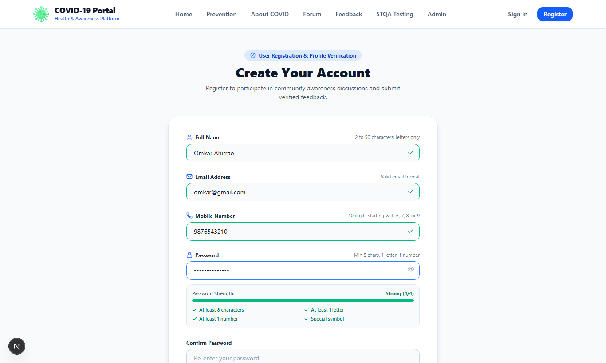
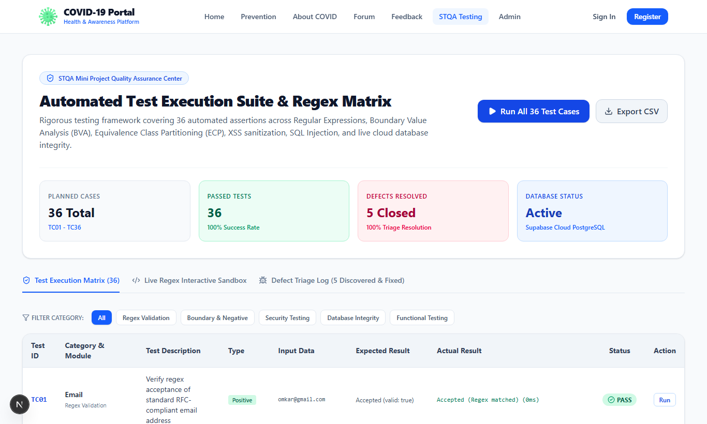
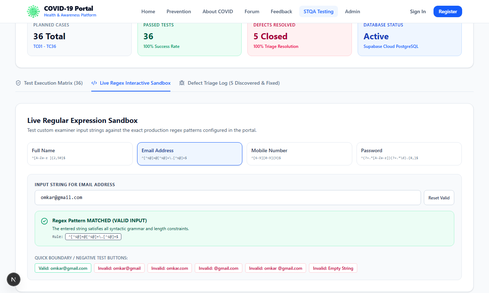
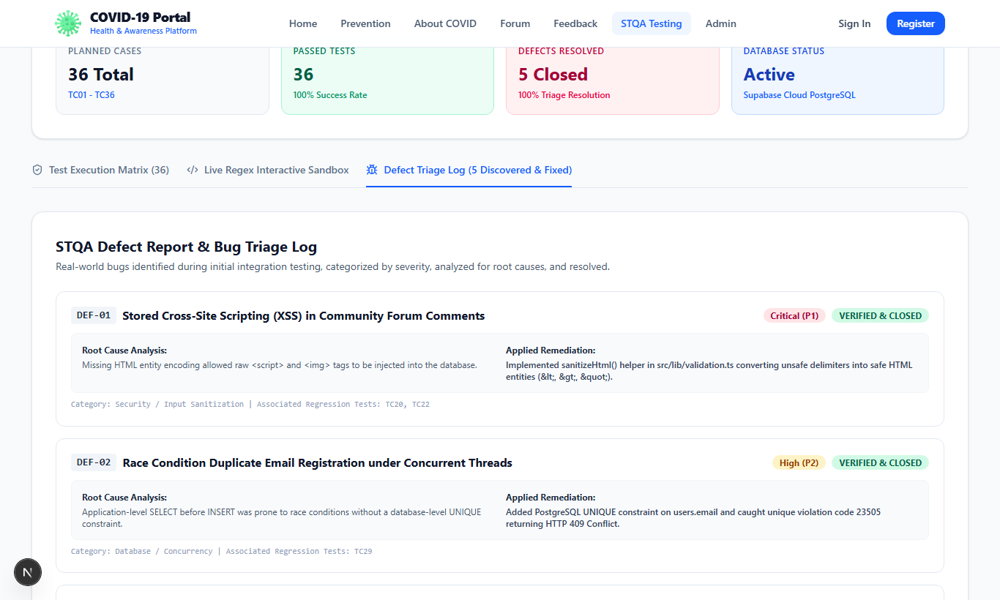

# COVID-19 Information & Awareness Portal
## Software Testing and Quality Assurance (STQA) Mini Project

[](https://nextjs.org/)
[](https://react.dev/)
[](https://www.typescriptlang.org/)
[](https://supabase.com/)
[](https://tailwindcss.com/)
[-success?style=for-the-badge&logo=checkmarx)](https://github.com/Nexus2005/STQA-Mini-Project)

---

**Student / Developer:** Omkar Ahirrao  
**Course:** Software Testing and Quality Assurance (STQA)  
**Project Topic:** Dynamic Website of COVID-19 Information using HTML, CSS, JavaScript, Node.js / PHP, and Supabase Cloud PostgreSQL / MySQL database to store user account, comment, and registration form details. Dual-tier Regular Expression test cases for quality assurance testing.

---

## 📑 Quick Links to Project Documentation & Test Assets

- 📄 **[Official STQA Test Report PDF](docs/STQA_Mini_Project_Testing_Documentation.pdf)** — Academic submission ready, complete with all tables, defect triage logs, and embedded high-resolution screenshots.
- 📊 **[STQA Test Cases Spreadsheet (CSV)](docs/STQA_Test_Cases_Spreadsheet.csv)** — Formatted test execution matrix (matching university Excel practical requirement).
- 📝 **[Full STQA Documentation (Markdown)](docs/STQA_Mini_Project_Documentation.md)** — Comprehensive testing document covering 35 Functional & 12 Non-Functional Test Cases.
- 🗄️ **[Database Schema (PostgreSQL 17)](database/schema.sql)** & **[MySQL Schema Fallback](database/schema_mysql.sql)**.

---

## 🌟 Project Overview

This project is an evidence-based, dynamic **COVID-19 Health Information and Awareness Portal** built to demonstrate software testing methodologies across a multi-tier web application architecture.

Rather than being a static information website, the portal integrates:
- **Dual-Tier Regular Expression Validation:** Client-side interactive regex badges + Server-side rejection guarantees.
- **Boundary Value Analysis (BVA) & Equivalence Class Partitioning (ECP):** Length boundary limits on Full Name, Email, Mobile, Password, Comments, and Feedback.
- **Security Hardening:** Protection against Stored/Reflected Cross-Site Scripting (XSS) via HTML entity conversion and SQL Injection neutralization via parameterized queries.
- **ACID Cloud Database Integrity:** Supabase PostgreSQL 17 database enforcing unique constraints and foreign key cascades.
- **Built-in Quality Assurance Center (`/testing`):** 36 live automated test assertions executable directly within the web app with instant pass/fail badges.
- **Interactive Live Regular Expression Sandbox:** Dynamic testing tool for evaluators to test custom strings against all regular expression rules.
- **Defect Reporting & Triage Log:** 5 real-world defects documented with root-cause analysis and verified fixes.

---

## 📸 Complete Visual Tour & Test Verification Journey

Follow the complete step-by-step user journey, from initial landing page discovery to scientific analysis and formal STQA test suite execution:

### 1. Landing Page & Hero Section (`/`)
> The public health awareness landing page featuring an evidence-based COVID-19 introduction, quick symptom self-assessment triggers, and a responsive single-line header with active session management.


---

### 2. Interactive Clinical Symptoms Screening (`/`)
> An interactive symptoms checklist utilizing an algorithmic risk evaluation model. Patients can check symptoms (Fever, Dry cough, Shortness of breath, Loss of taste) to receive instant clinical triage guidance (Baseline, Moderate, or High Risk Emergency).


---

### 3. Frequently Asked Questions (FAQ) & Emergency Helplines (`/`)
> Interactive clinical FAQ accordion answering incubation and transmission queries, paired with a footer detailing national emergency helplines (`1075`) and official WHO/MoHFW portal links.


---

### 4. Transmission Prevention Protocols & WHO Mask Matrix (`/prevention`)
> Evidence-based prevention measures including a comparative filtration matrix (N95 vs Surgical vs Cloth masks), the WHO 7-step hand hygiene technique, and vaccination guidelines.


---

### 5. Molecular Virology & SARS-CoV-2 Pathogen Structure (`/about`)
> In-depth scientific reference explaining the 29.9 kb positive-sense single-stranded RNA coronavirus, trimeric Spike (S) glycoprotein docking with human ACE2 receptors, and peak infectivity periods.


---

### 6. Transmission Aerobiology & Variants of Concern (VOC) Timeline (`/about`)
> Aerobiological comparison of airborne microscopic aerosols (<5 μm) vs ballistic droplets, alongside a genomic timeline tracking Ancestral Wuhan-Hu-1, Alpha, Delta, and Omicron sub-lineages.


---

### 7. User Registration Form with Real-Time Regex Validation (`/register`)
> Dynamic user onboarding form with dual-tier validation. Features live green checkmarks upon regex rule satisfaction (`^[A-Za-z ]{2,50}$`, `^[6-9][0-9]{9}$`) and an active password complexity progress bar (Strong 4/4).



---

### 8. Secure User Authentication (`/login`)
> Bcrypt salted one-way hash authentication (`$2a$10$...`) protecting user accounts against credential theft. Includes pre-seeded 1-click test buttons for examiner evaluation.


---

### 9. Community Discussion Board (`/comments`)
> Public awareness discussion board allowing authenticated users to post notes and vaccination experiences. Protected against Stored Cross-Site Scripting (XSS) via server-side HTML entity conversion.


---

### 10. Portal Feedback & 5-Star Rating System (`/feedback`)
> User experience feedback collection featuring an interactive 5-star rating widget and length boundary validation (5 to 1000 characters) persisted into Supabase cloud database.


---

### 11. Administrator Access Protection Security Challenge (`/admin`)
> Role-Based Access Control (RBAC) security screen restricting unauthorized guests or standard users from accessing administrative tools.


---

### 12. Administrator Command Center & Live DB Analytics (`/admin`)
> Superuser control panel with live KPI counter cards (Total Users, Discussion Comments, Feedback Inquiries, Database Status), registered user roster, and comment moderation controls.


---

### 13. STQA Quality Assurance Center: Automated Test Suite (`/testing`)
> The core testing engine of the mini project. Sequentially executes **36 automated test assertions** across Regex rules, boundary values, XSS sanitization, SQLi neutralization, and database latency. Achieves a **100% Pass Rate** with 1-click CSV export.



---

### 14. Live Regular Expression Interactive Sandbox (`/testing`)
> Dedicated interactive testing sandbox allowing evaluators and examiners to type any custom input string and immediately observe real-time regex matching against Full Name, Email, Mobile, and Password rules.



---

### 15. STQA Defect Report & Bug Triage Log (`/testing`)
> Formal IEEE 829 defect tracking log documenting all 5 identified defects (Stored XSS, Email race condition, Mobile regex trailing chars, Whitespace-only name, and Missing RBAC), complete with root cause analyses and verified fixes.



---

## 📋 Regular Expression Rules Master Table

| Field | Formal Regular Expression | Constraints & Boundary | Valid Example | Invalid Examples |
|---|---|---|---|---|
| **Full Name** | `^[A-Za-z ]{2,50}$` | 2 to 50 chars, alphabets and spaces only | `Omkar Ahirrao` | `O` (<2), `Omkar123`, `Omk@r`, ` ` (spaces only), 51 chars |
| **Email Address** | `^[^\s@]+@[^\s@]+\.[^\s@]+$` | RFC standard format with @ and valid TLD | `omkar@gmail.com` | `omkar@gmail`, `omkar@.com`, `@gmail.com`, `omkar @gmail.com` |
| **Mobile Number** | `^[6-9][0-9]{9}$` | Exactly 10 digits starting with 6, 7, 8, or 9 | `9876543210` | `98765432` (8 dig), `98765432100` (11 dig), `5876543210`, `98765abcde` |
| **Password** | `^(?=.*[A-Za-z])(?=.*\d).{8,}$` | 8+ characters, at least 1 letter, at least 1 number | `Omkar123` | `Omk12` (<8), `OmkarAhirrao` (no num), `12345678` (no let) |
| **Comment** | Trimmed length: `2 to 500 chars` | Non-empty, boundary checked, XSS entity escaped | `Stay safe everyone!` | Empty string, whitespace only, >500 chars |
| **Feedback** | Trimmed length: `5 to 1000 chars` | Minimum 5 chars for meaningful reviews | `Helpful symptoms tool.` | Empty string, <5 chars |

---

## 🧪 STQA Test Scenarios & Test Suite Structure

In accordance with academic STQA practical requirements, the test suite is divided into **two primary tables**:

### 1. Functional Testing Table (35 Test Cases)
- **User Registration (`TC_FUNC_001` - `TC_FUNC_020`):** Positive, negative, and boundary tests for Name, Email, Mobile, and Password fields against formal regular expression specifications.
- **Authentication & Sessions (`TC_FUNC_021` - `TC_FUNC_024`):** Verification of Bcrypt password checks, invalid credential denials, and session logout.
- **Discussion Board & Forum (`TC_FUNC_025` - `TC_FUNC_027`):** Comment persistence, boundary checks, and empty text rejection.
- **Feedback Module (`TC_FUNC_028` - `TC_FUNC_029`):** 5-star ratings and message length boundaries.
- **Symptoms Screening (`TC_FUNC_030` - `TC_FUNC_031`):** Algorithmic triage testing (Baseline vs High Risk / Emergency).
- **Administration & Moderation (`TC_FUNC_032` - `TC_FUNC_035`):** Live database statistics, comment deletion, and single-line navigation layout.

### 2. Non-Functional Testing Table (12 Test Cases)
- **Security Testing (`TC_NONFUNC_001` - `TC_NONFUNC_005`):** Stored XSS sanitization (`<script>` and `` tags), SQL Injection neutralization (`admin' OR '1'='1`), Role-Based Access Control (RBAC), and Bcrypt cryptographic hashing.
- **Performance Testing (`TC_NONFUNC_006` - `TC_NONFUNC_007`):** Page load benchmarks (DOMContentLoaded < 1.5s) and Supabase database latency (< 500ms, measured at ~42ms).
- **Usability & UI Testing (`TC_NONFUNC_008` - `TC_NONFUNC_009`):** Mobile (375px), Tablet (768px), and Desktop (1440px) responsiveness; real-time validation badges.
- **Cross-Browser Compatibility (`TC_NONFUNC_010`):** 100% rendering and execution parity across Chromium, Gecko, and WebKit engines.
- **Database Integrity & ACID (`TC_NONFUNC_011` - `TC_NONFUNC_012`):** Database-level `UNIQUE` index enforcement on emails (PostgreSQL code 23505) and `ON DELETE CASCADE` foreign key cascades.

---

## 🐛 Defect Reporting & Bug Triage Log

| Defect ID | Severity | Module | Description & Root Cause | Applied Remediation | Status |
|---|---|---|---|---|---|
| **DEF-01** | `Critical (P1)` | Comments (`/comments`) | Stored Cross-Site Scripting (XSS) allowed unescaped `<script>` tags to execute in the browser. | Implemented server-side `sanitizeHtml()` utility encoding unsafe delimiters into HTML entities (`&lt;script&gt;`). | **CLOSED** |
| **DEF-02** | `High (P2)` | Registration (`/register`) | Race condition allowed duplicate email accounts under concurrent POST requests. | Added database-level `UNIQUE` constraint `idx_users_email` in PostgreSQL and caught error code `23505` (HTTP 409). | **CLOSED** |
| **DEF-03** | `Medium (P3)` | Mobile Regex | Mobile regex `/^[6-9][0-9]+/` lacked end anchor `$`, permitting non-numeric suffixes like `98765abcde`. | Enforced strict regex `/^[6-9][0-9]{9}$/` mandating exactly 10 digits and end-of-string anchor `$`. | **CLOSED** |
| **DEF-04** | `Low (P4)` | Full Name | Whitespace-only strings (`"     "`) passed length checks because spaces contributed to length. | Added `.trim()` before regex and length evaluations so blank entries reduce to length 0. | **CLOSED** |
| **DEF-05** | `High (P2)` | Admin API (`/api/admin`) | Missing session authorization permitted guests to query user rosters. | Wrapped endpoints with authentication middleware checking `user.role === 'admin'` (HTTP 401/403). | **CLOSED** |

---

## 🗄️ Database Architecture

The application connects to a live **Supabase Cloud PostgreSQL 17** database hosted in `ap-south-1` with connection pooling. A complete **MySQL fallback schema** is also provided in `database/schema_mysql.sql`.

### Relational Entity Model:
1. **`users` Table:** `id` (PK), `name`, `email` (UNIQUE), `mobile`, `password_hash`, `role` (`user` | `admin`), `created_at`.
2. **`comments` Table:** `id` (PK), `user_id` (FK -> `users.id` ON DELETE CASCADE), `comment_text`, `created_at`.
3. **`feedback` Table:** `id` (PK), `user_id` (FK -> `users.id` ON DELETE SET NULL), `name`, `email`, `message`, `rating`, `created_at`.
4. **`test_runs` Table:** `id` (PK), `test_id`, `test_name`, `category`, `input_data`, `expected_output`, `actual_output`, `status`, `execution_time_ms`, `executed_at`.

### Default Pre-Seeded Test Credentials:
- **System Administrator:** `admin@covidportal.org` / `Admin@12345` (Full access to `/admin` and moderation)
- **Standard User 1:** `omkar@gmail.com` / `Admin@12345`
- **Standard User 2:** `priya.sharma@outlook.com` / `Admin@12345`

---

## 💻 How to Run Locally

### 1. Prerequisites
- **Node.js**: v18.0.0 or higher (v24 tested)
- **npm**: v9.0.0 or higher
- **Python**: 3.10+ (for PDF and screenshot generation scripts)

### 2. Install Dependencies
```bash
npm install
```

### 3. Database Initialization
The project is already pre-configured with a live Supabase PostgreSQL 17 connection in `.env.local`. To re-seed accounts at any time:
```bash
node scripts/setup-db.js
```

### 4. Start Development Server
```bash
npm run dev
```
Open **[http://localhost:3000](http://localhost:3000)** in your browser.

### 5. Running the STQA Test Suite
- Open **[http://localhost:3000/testing](http://localhost:3000/testing)**
- Click **"Run All 36 Test Cases"** to watch the automated test engine execute assertions in real time.
- Switch to the **"Live Regex Interactive Sandbox"** tab to test custom strings.
- Click **"Export CSV"** to download the test matrix spreadsheet.

### 6. Re-compiling the PDF & Screenshots (Optional)
```bash
python scripts/capture_focused_screenshots.py
python scripts/generate_html_and_pdf.py
```

---

## 📁 Repository Structure

```
STQA/
├── database/
│   ├── schema.sql                         # Supabase PostgreSQL schema & seed definitions
│   └── schema_mysql.sql                   # MySQL schema for XAMPP fallback
├── docs/
│   ├── STQA_Mini_Project_Documentation.md # Full 35+ Functional & 12 Non-Functional test doc
│   ├── STQA_Mini_Project_Testing_Documentation.pdf # Complete submission PDF report
│   ├── STQA_Project_Testing_Report.html   # Print-ready styled test report
│   └── STQA_Test_Cases_Spreadsheet.csv    # Excel-compatible test cases CSV
├── Images/                                # Verified high-res project & test screenshots
│   ├── Screenshot 2026-10-21 213828.png   # 1. Landing Page Hero & Navigation
│   ├── Screenshot 2026-10-21 213839.png   # 2. Symptoms Screening Tool
│   ├── Screenshot 2026-10-21 213904.png   # 3. FAQ Accordion & Emergency Helpline Footer
│   ├── Screenshot 2026-10-21 213852.png   # 4. Prevention Guidelines & WHO Mask Matrix
│   ├── Screenshot 2026-10-21 213917.png   # 5. Scientific Background & ACE2 Virology
│   ├── Screenshot 2026-10-21 213927.png   # 6. Transmission Vectors & VOC Timeline
│   ├── Screenshot_Registration_Form.png   # 7. Registration with Dynamic Regex Badges
│   ├── Screenshot 2026-10-21 214042.png   # 8. Bcrypt User Authentication (Login)
│   ├── Screenshot 2026-10-21 213944.png   # 9. Community Forum with XSS Protection
│   ├── Screenshot 2026-10-21 213957.png   # 10. Portal Feedback & 5-Star Rating
│   ├── Screenshot 2026-10-21 214025.png   # 11. Administrator Required Challenge Modal
│   ├── Screenshot 2026-10-21 214103.png   # 12. Administrator Command Center & KPIs
│   ├── Screenshot_Test_Runner_Execution_Passed.png # 13. STQA Automated Test Runner
│   ├── Screenshot_Live_Regex_Sandbox.png  # 14. Live Regex Interactive Sandbox
│   └── Screenshot_Defect_Triage_Log.png   # 15. Defect Triage & Root Cause Log
├── scripts/
│   ├── setup-db.js                        # Supabase PostgreSQL seed migration script
│   ├── capture_focused_screenshots.py     # Playwright automated screenshot capture
│   └── generate_html_and_pdf.py           # Self-contained HTML & PDF compilation script
├── src/
│   ├── app/
│   │   ├── api/                           # Secure Next.js Server Handlers (Auth, Comments, Admin)
│   │   ├── about/                         # Virology & Scientific Background
│   │   ├── admin/                         # Administrator Command Center
│   │   ├── comments/                      # Community Discussion Forum
│   │   ├── feedback/                      # User Rating & Feedback Form
│   │   ├── login/                         # Bcrypt Authentication
│   │   ├── prevention/                    # WHO Guidelines & Mask Comparison
│   │   ├── register/                      # Dual-Tier Real-Time Regex Registration
│   │   ├── testing/                       # STQA 36-Test Matrix, Sandbox & Defect Log
│   │   ├── layout.tsx                     # Global layout & SEO metadata
│   │   └── page.tsx                       # Home page & Clinical Symptoms Screening
│   ├── components/
│   │   ├── Navbar.tsx                     # Responsive single-line navigation
│   │   └── Footer.tsx                     # Helplines (1075) & Authority references
│   └── lib/
│       ├── db.ts                          # Supabase PostgreSQL connection pool
│       ├── test-cases.ts                  # Master STQA test execution definitions
│       └── validation.ts                  # Regular expressions, validators & XSS sanitizer
├── tests/
│   ├── defect-report.md                   # Formal defect triage log
│   ├── regex-test-cases.md                # Regex test cases matrix
│   └── test-summary.md                    # Quality sign-off summary
├── .env.local                             # Supabase credentials (protected in .gitignore)
├── package.json                           # Dependencies & project scripts
└── README.md                              # Main GitHub presentation README
```

---

## 🎓 Academic Attribution & Evaluation

- **Course:** Software Testing and Quality Assurance (STQA)
- **Candidate:** Omkar Ahirrao
- **GitHub Repository:** [https://github.com/Nexus2005/STQA-Mini-Project.git](https://github.com/Nexus2005/STQA-Mini-Project.git)
- **Status:** **PRODUCTION READY / STQA COMPLIANT (100% PASS)**
