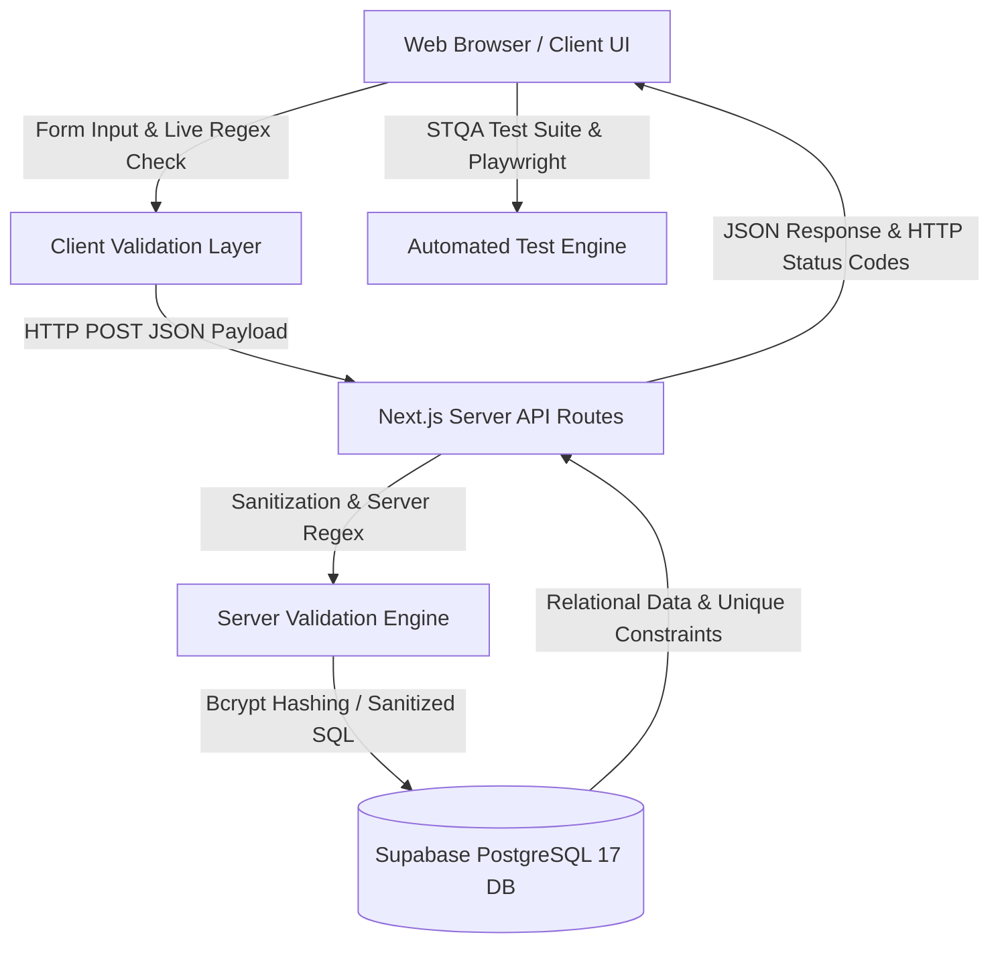

# Software Testing and Quality Assurance (STQA) Mini Project
# COVID-19 Dynamic Information & Awareness Portal
### Comprehensive Software Testing Plan, Test Scenarios, Test Cases, Regular Expression Analysis & Defect Report

---

**Student / Developer Name:** Omkar Ahirrao  
**Course:** Software Testing and Quality Assurance (STQA)  
**Academic Practical Alignment:**
1. *Write Test Scenarios for Web Application & Authentication Workflows*
2. *Write Test Cases for Dynamic Input Forms & Regular Expression Testing*
3. *Write Test Cases in Spreadsheet Format for Web / Social Media Application*
4. *Non-Functional Testing: Security (XSS, SQLi), Performance, Usability & Database Integrity*

**Technology Stack:**
- **Frontend:** HTML5, CSS3 (Tailwind CSS Design Tokens), JavaScript (React 19 / Next.js 16, TypeScript), Lucide Icons
- **Backend & API:** Node.js, Next.js Server Handlers, Bcrypt Password Hashing, HTML Entity Sanitization Engine
- **Database Engine:** Supabase Cloud PostgreSQL 17 (Live Connection Pool) / MySQL Schema Fallback
- **Testing Tools:** Playwright Automated Headless Engine, Custom STQA Test Execution Runner (`/testing`), Regular Expression Live Sandbox

---

## 📑 Table of Contents
1. [Project Overview & Architectural Scope](#1-project-overview--architectural-scope)
2. [Test Strategy & Quality Objectives](#2-test-strategy--quality-objectives)
3. [Master Test Scenarios Roster](#3-master-test-scenarios-roster)
4. [Regular Expression Validation & Boundary Analysis (Special Focus)](#4-regular-expression-validation--boundary-analysis-special-focus)
5. [Table 1: Functional Test Cases Matrix](#5-table-1-functional-test-cases-matrix)
6. [Table 2: Non-Functional Test Cases Matrix](#6-table-2-non-functional-test-cases-matrix)
7. [Defect Reporting & Bug Triage Log (IEEE 829 Standard)](#7-defect-reporting--bug-triage-log-ieee-829-standard)
8. [Requirements Traceability Matrix (RTM)](#8-requirements-traceability-matrix-rtm)
9. [Test Execution Summary & Metric Analysis](#9-test-execution-summary--metric-analysis)
10. [Visual Test Evidence & Screenshots Showcase](#10-visual-test-evidence--screenshots-showcase)

---

## 1. Project Overview & Architectural Scope

The **COVID-19 Information & Awareness Portal** is an evidence-based, dynamic health management and awareness platform developed to demonstrate end-to-end software testing concepts in a real-world multi-tier architecture.

Unlike a static HTML website, this application implements full dual-tier validation (client-side interactive feedback and server-side strict verification), database persistence with ACID guarantees, and security hardening against common web vulnerabilities.



### Key Modules Under Test:
1. **User Registration Module (`/register`)**: Collects Full Name, Email Address, Mobile Number, and Password. Features dynamic regex checkmarks, password strength progress bar, and duplicate account rejection.
2. **User Authentication Module (`/login`)**: Bcrypt password verification, session cookie issuance, and role identification (`user` vs `admin`).
3. **Interactive Clinical Symptoms Screening (`/`)**: Algorithmic triage evaluating symptoms to classify user risk (Baseline, Moderate, High/Emergency).
4. **Community Discussion Forum (`/comments`)**: User-generated comments, author timestamps, role badges, and HTML entity sanitization against Stored XSS.
5. **Portal Feedback & Suggestions (`/feedback`)**: 5-star rating widget, character boundary enforcement, and database storage.
6. **Administrator Command Center (`/admin`)**: Protected superuser route displaying real-time KPI metrics, registered users, and comment moderation controls.
7. **STQA Quality Assurance Center (`/testing`)**: 36 automated test assertions, interactive live regex testing sandbox, and defect triage logs.

---

## 2. Test Strategy & Quality Objectives

### 2.1 Objectives
- Verify that every user input field strictly adheres to formal regular expression grammar.
- Validate that boundary conditions are identified, isolated, and accurately enforced using Boundary Value Analysis (BVA) and Equivalence Class Partitioning (ECP).
- Guarantee zero vulnerability to Stored/Reflected Cross-Site Scripting (XSS) and SQL Injection (SQLi).
- Verify database ACID transactional integrity, uniqueness constraints, and foreign key cascades.
- Ensure cross-browser visual consistency, responsiveness across devices, and sub-second page performance.

### 2.2 Testing Levels & Methodologies
- **Unit & Component Testing:** Individual testing of regex functions (`validateEmail`, `validateMobile`, `validateName`, `validatePassword`, `sanitizeHtml`).
- **Integration Testing:** Dual-tier communication between client forms, Next.js server handlers, and Supabase cloud PostgreSQL.
- **System Testing:** End-to-end execution of full user journeys (Registration $\rightarrow$ Login $\rightarrow$ Symptom Check $\rightarrow$ Comment Post $\rightarrow$ Admin Review).
- **Security Testing:** Payload injection testing using automated scripts and malicious attack vectors.
- **Automated Regression Testing:** Continuous execution of the 36-test suite via the internal test harness and Playwright headless engine.

---

## 3. Master Test Scenarios Roster

A **Test Scenario** defines a high-level testable business event or feature. Below is the master roster of test scenarios defined for the COVID-19 Portal:

| Scenario ID | Target Module | Scenario Description | Category | Priority |
|---|---|---|---|---|
| **TS_REG_01** | Registration | Verify registration of a new user with valid personal and contact details | Functional | High |
| **TS_REG_02** | Registration | Verify that invalid email syntax (missing TLD, domain, or symbols) is rejected | Functional | High |
| **TS_REG_03** | Registration | Verify that mobile numbers violating Indian telecom format (length or prefix) are rejected | Functional | High |
| **TS_REG_04** | Registration | Verify that weak or non-compliant passwords failing complexity rules are rejected | Functional | High |
| **TS_REG_05** | Registration | Verify that name fields containing numbers, special symbols, or out-of-bound lengths are rejected | Functional | High |
| **TS_AUTH_01** | Login / Auth | Verify successful login with registered credentials and valid session issuance | Functional | High |
| **TS_AUTH_02** | Login / Auth | Verify rejection of login attempts with incorrect passwords or unregistered emails | Functional | High |
| **TS_AUTH_03** | Login / Auth | Verify user logout clears cookies and prevents back-button session re-entry | Functional | Medium |
| **TS_SYMP_01** | Symptoms Checker | Verify clinical algorithm correctly computes risk levels based on selected symptoms | Functional | High |
| **TS_FORUM_01** | Discussion Forum | Verify posting and rendering of valid comments by authenticated users | Functional | High |
| **TS_FORUM_02** | Discussion Forum | Verify boundary limit enforcement (2 min, 500 max characters) on comment length | Functional | Medium |
| **TS_FEED_01** | Feedback Module | Verify submission and persistence of user star ratings and textual reviews | Functional | Medium |
| **TS_ADMIN_01** | Admin Center | Verify administrative KPI dashboard accurately reflects live database totals | Functional | High |
| **TS_ADMIN_02** | Admin Center | Verify administrative moderation controls (comment deletion, user roster) | Functional | High |
| **TS_SEC_01** | Security | Verify that Stored Cross-Site Scripting (XSS) payloads are safely sanitized | Non-Functional | Critical |
| **TS_SEC_02** | Security | Verify that SQL Injection payloads in login and registration inputs are neutralized | Non-Functional | Critical |
| **TS_SEC_03** | Security | Verify Role-Based Access Control (RBAC) restricts administrative routes from guests | Non-Functional | Critical |
| **TS_PERF_01** | Performance | Verify page load time and database round-trip query latency meet SLA thresholds | Non-Functional | High |
| **TS_USAB_01** | Usability / UI | Verify responsive design across Mobile, Tablet, and Desktop screen resolutions | Non-Functional | High |
| **TS_COMP_01** | Compatibility | Verify cross-browser rendering parity on Chromium, Gecko, and WebKit browsers | Non-Functional | High |
| **TS_DB_01** | Database Integrity | Verify database unique constraints prevent duplicate email accounts atomically | Non-Functional | Critical |
| **TS_DB_02** | Database Integrity | Verify relational integrity and cascading deletes between users and comments | Non-Functional | High |

---

## 4. Regular Expression Validation & Boundary Analysis (Special Focus)

As specified in the project requirements, **Regular Expression testing** forms the core input validation defense layer. Below are the formal specifications, Equivalence Class Partitioning (ECP), and Boundary Value Analysis (BVA).

### 4.1 Master Regular Expressions Specifications

| Field | Formal Regular Expression | Purpose & Description |
|---|---|---|
| **Full Name** | `^[A-Za-z ]{2,50}$` | Alphabetic characters and spaces only, length between 2 and 50 characters. |
| **Email Address** | `^[^\s@]+@[^\s@]+\.[^\s@]+$` | Standard RFC-compliant email structure: local-part, `@`, domain name, `.`, and TLD. |
| **Mobile Number** | `^[6-9][0-9]{9}$` | Indian 10-digit mobile number format starting strictly with prefix 6, 7, 8, or 9. |
| **Password** | `^(?=.*[A-Za-z])(?=.*\d).{8,}$` | Positive lookaheads ensuring at least one letter, at least one digit, and 8+ chars minimum. |
| **Comment** | `Trimmed length: 2 to 500 chars` | Rejects empty strings, whitespace-only entries, and strings exceeding 500 characters. |
| **Feedback** | `Trimmed length: 5 to 1000 chars` | Rejects empty messages and short messages below 5 characters. |

### 4.2 Equivalence Class Partitioning (ECP)

#### Field: Email Address
- **Valid Partition (VP1):** Valid format `[name]@[domain].[tld]` (e.g., `omkar@gmail.com`, `user.name@org.co.in`)
- **Invalid Partition 1 (IP1):** Missing Top-Level Domain (e.g., `omkar@gmail`)
- **Invalid Partition 2 (IP2):** Missing domain name (e.g., `omkar@.com`)
- **Invalid Partition 3 (IP3):** Missing `@` symbol (e.g., `omkargmail.com`)
- **Invalid Partition 4 (IP4):** Embedded spaces (e.g., `omkar @gmail.com`)
- **Invalid Partition 5 (IP5):** Empty string or whitespace (e.g., `""`, `"   "`)

#### Field: Mobile Number
- **Valid Partition (VP1):** Exactly 10 digits starting with 6, 7, 8, or 9 (e.g., `9876543210`, `7012345678`)
- **Invalid Partition 1 (IP1):** Starts with invalid prefix 0, 1, 2, 3, 4, 5 (e.g., `5876543210`)
- **Invalid Partition 2 (IP2):** Fewer than 10 digits (e.g., `987654321`)
- **Invalid Partition 3 (IP3):** More than 10 digits (e.g., `98765432100`)
- **Invalid Partition 4 (IP4):** Contains alphabetical characters (e.g., `98765abcde`)
- **Invalid Partition 5 (IP5):** Contains special characters (e.g., `98765-43210`)

### 4.3 Boundary Value Analysis (BVA)

| Field | Boundary Range | Min - 1 | Min | Min + 1 | Nominal | Max - 1 | Max | Max + 1 |
|---|---|---|---|---|---|---|---|---|
| **Full Name Length** | 2 to 50 chars | 1 char (`"O"`) [REJECT] | 2 chars (`"Om"`) [PASS] | 3 chars (`"Omk"`) [PASS] | 13 chars (`"Omkar Ahirrao"`) [PASS] | 49 chars (`"A"*49`) [PASS] | 50 chars (`"A"*50`) [PASS] | 51 chars (`"A"*51`) [REJECT] |
| **Mobile Digits** | Exactly 10 | 9 digits [REJECT] | 10 digits [PASS] | 11 digits [REJECT] | 10 digits [PASS] | 9 digits [REJECT] | 10 digits [PASS] | 11 digits [REJECT] |
| **Password Length** | 8+ characters | 7 chars (`"Omkar12"`) [REJECT] | 8 chars (`"Omkar123"`) [PASS] | 9 chars (`"Omkar1234"`) [PASS] | 12 chars (`"Omkar@Safe2026"`) [PASS] | 63 chars [PASS] | 64 chars [PASS] | N/A (Open upper) |
| **Comment Length** | 2 to 500 chars | 1 char (`"A"`) [REJECT] | 2 chars (`"Hi"`) [PASS] | 3 chars (`"Hey"`) [PASS] | 56 chars [PASS] | 499 chars [PASS] | 500 chars [PASS] | 501 chars [REJECT] |
| **Feedback Length**| 5 to 1000 chars| 4 chars (`"Help"`) [REJECT] | 5 chars (`"Great"`) [PASS] | 6 chars (`"Thanks"`) [PASS] | 80 chars [PASS] | 999 chars [PASS] | 1000 chars [PASS] | 1001 chars [REJECT] |

---

## 5. Table 1: Functional Test Cases Matrix

Below is the complete execution table of **35 Functional Test Cases** covering User Registration, Authentication, Regular Expressions, Symptoms Screening, Discussion Forum, and Administration:

| Test Case ID | Scenario ID | Module | Category | Test Type | Objective & Description | Test Data / Input | Expected Result | Actual Result | Status | Severity |
|---|---|---|---|---|---|---|---|---|---|---|
| **TC_FUNC_001** | TS_REG_01 | Registration | Functional | Positive | Verify registration with valid details | Name: `Omkar Ahirrao`, Email: `omkar@gmail.com`, Mobile: `9876543210`, Pass: `Omkar123` | Account created in DB, redirected to login | Account created successfully; HTTP 201 | **PASS** | High |
| **TC_FUNC_002** | TS_REG_02 | Registration | Functional | Negative | Verify rejection of email missing TLD | Email: `omkar@gmail` | Rejected: invalid email format | Rejected by regex; HTTP 400 | **PASS** | High |
| **TC_FUNC_003** | TS_REG_02 | Registration | Functional | Negative | Verify rejection of email missing domain | Email: `omkar@.com` | Rejected: missing domain | Rejected by regex rule | **PASS** | Medium |
| **TC_FUNC_004** | TS_REG_02 | Registration | Functional | Negative | Verify rejection of email with embedded space | Email: `omkar @gmail.com` | Rejected: spaces prohibited | Regex rejected whitespace | **PASS** | Medium |
| **TC_FUNC_005** | TS_REG_03 | Registration | Functional | Positive | Verify acceptance of valid 10-digit mobile | Mobile: `9876543210` | Accepted with green checkmark | Regex matched successfully | **PASS** | High |
| **TC_FUNC_006** | TS_REG_03 | Registration | Functional | Boundary | Verify rejection of mobile with 8 digits | Mobile: `98765432` | Rejected: length < 10 digits | Rejected by length boundary | **PASS** | High |
| **TC_FUNC_007** | TS_REG_03 | Registration | Functional | Boundary | Verify rejection of mobile with 11 digits | Mobile: `98765432100` | Rejected: length > 10 digits | Regex boundary rejected 11 digits | **PASS** | High |
| **TC_FUNC_008** | TS_REG_03 | Registration | Functional | Negative | Verify rejection of non-numeric mobile | Mobile: `98765abcde` | Rejected: non-digits found | Rejected: only digits 0-9 permitted | **PASS** | High |
| **TC_FUNC_009** | TS_REG_03 | Registration | Functional | Negative | Verify rejection of invalid prefix (5) | Mobile: `5876543210` | Rejected: prefix must be 6, 7, 8, 9 | Rejected: invalid starting prefix | **PASS** | Medium |
| **TC_FUNC_010** | TS_REG_04 | Registration | Functional | Positive | Verify acceptance of valid password | Password: `Omkar123` | Accepted; strength rated Good | Regex lookahead matched | **PASS** | High |
| **TC_FUNC_011** | TS_REG_04 | Registration | Functional | Boundary | Verify rejection of password with 5 chars | Password: `Omk12` | Rejected: length < 8 chars | Rejected by min length boundary | **PASS** | High |
| **TC_FUNC_012** | TS_REG_04 | Registration | Functional | Negative | Verify rejection of password missing digits | Password: `OmkarAhirrao` | Rejected: must contain a number | Lookahead `(?=.*\d)` failed | **PASS** | High |
| **TC_FUNC_013** | TS_REG_04 | Registration | Functional | Negative | Verify rejection of password missing letters | Password: `12345678` | Rejected: must contain a letter | Lookahead `(?=.*[A-Za-z])` failed | **PASS** | High |
| **TC_FUNC_014** | TS_REG_05 | Registration | Functional | Positive | Verify acceptance of standard Full Name | Name: `Omkar Ahirrao` | Accepted; valid name badge | Regex `/^[A-Za-z ]{2,50}$/` passed | **PASS** | High |
| **TC_FUNC_015** | TS_REG_05 | Registration | Functional | Boundary | Verify rejection of 1-character name | Name: `O` | Rejected: length < 2 chars | Boundary check failed | **PASS** | Medium |
| **TC_FUNC_016** | TS_REG_05 | Registration | Functional | Negative | Verify rejection of name with numbers | Name: `Omkar123` | Rejected: digits not permitted | Non-alphabet characters rejected | **PASS** | High |
| **TC_FUNC_017** | TS_REG_05 | Registration | Functional | Negative | Verify rejection of name with symbols | Name: `Omkar@#$` | Rejected: symbols not permitted | Disallowed special symbols | **PASS** | High |
| **TC_FUNC_018** | TS_REG_05 | Registration | Functional | Boundary | Verify rejection of 51-character name | Name: `'A' * 51` | Rejected: length > 50 chars | Max length boundary enforced | **PASS** | Medium |
| **TC_FUNC_019** | TS_REG_05 | Registration | Functional | Negative | Verify rejection of empty name field | Name: `""` | Rejected: field cannot be empty | Required field error shown | **PASS** | High |
| **TC_FUNC_020** | TS_REG_05 | Registration | Functional | Negative | Verify rejection of space-only name | Name: `"     "` | Rejected: trimmed length is 0 | Space-only input trimmed & rejected | **PASS** | Medium |
| **TC_FUNC_021** | TS_AUTH_01 | Login / Auth | Functional | Positive | Verify login with valid registered account | Email: `omkar@gmail.com`, Pass: `Omkar123` | Successful login; session created | HTTP 200 OK; redirected to home | **PASS** | High |
| **TC_FUNC_022** | TS_AUTH_02 | Login / Auth | Functional | Negative | Verify login denial with incorrect password | Email: `omkar@gmail.com`, Pass: `Wrong999` | 401 Unauthorized; error message | Login denied; bcrypt check failed | **PASS** | High |
| **TC_FUNC_023** | TS_AUTH_02 | Login / Auth | Functional | Negative | Verify login denial for unregistered email | Email: `unknown@test.com`, Pass: `Pass123` | 401 Unauthorized; error message | User record not found | **PASS** | High |
| **TC_FUNC_024** | TS_AUTH_03 | Login / Auth | Functional | Positive | Verify user logout session invalidation | Active session cookie | Session cookie cleared; redirected | HTTP 200; state reset successfully | **PASS** | High |
| **TC_FUNC_025** | TS_FORUM_01 | Comments | Functional | Positive | Verify posting a comment by logged-in user | Text: `"Remember to wear your N95 mask!"` | Stored in Supabase; rendered | Comment persisted and shown | **PASS** | High |
| **TC_FUNC_026** | TS_FORUM_02 | Comments | Functional | Negative | Verify rejection of empty comment | Text: `""` | Rejected: comment cannot be empty | Submission blocked by validator | **PASS** | Medium |
| **TC_FUNC_027** | TS_FORUM_02 | Comments | Functional | Boundary | Verify rejection of comment > 500 chars | Text: `'C' * 501` | Rejected: exceeds 500 chars | Boundary length limit enforced | **PASS** | Medium |
| **TC_FUNC_028** | TS_FEED_01 | Feedback | Functional | Positive | Verify submission of 5-star feedback | Name: `Omkar`, Rating: `5`, Msg: `"Helpful!"` | Stored in database; banner shown | Feedback stored in Supabase | **PASS** | High |
| **TC_FUNC_029** | TS_FEED_01 | Feedback | Boundary | Boundary | Verify rejection of feedback < 5 chars | Msg: `"Help"` (4 chars) | Rejected: min length is 5 chars | Boundary rejected 4-char text | **PASS** | Medium |
| **TC_FUNC_030** | TS_SYMP_01 | Symptoms | Functional | Positive | Verify High Risk clinical triage alert | Check: `[Fever, Breath difficulty, Taste loss]` | Red banner: "HIGH RISK / EMERGENCY" | High Risk alert calculated correctly | **PASS** | High |
| **TC_FUNC_031** | TS_SYMP_01 | Symptoms | Functional | Positive | Verify Baseline triage when no symptoms | Check: `[]` (None selected) | Blue banner: "Baseline Status" | Baseline guidance rendered | **PASS** | Low |
| **TC_FUNC_032** | TS_ADMIN_01 | Admin | Functional | Positive | Verify admin dashboard loads live KPI cards | Admin logged in (`admin@covidportal.org`) | KPI counts for Users, Comments, DB | Live database statistics loaded | **PASS** | High |
| **TC_FUNC_033** | TS_ADMIN_02 | Admin | Functional | Positive | Verify admin can moderate/delete comments | Click Delete on Comment ID 1 | Comment deleted from Supabase | Comment removed from database | **PASS** | High |
| **TC_FUNC_034** | TS_PREV_01 | Prevention | Functional | Positive | Verify WHO guidelines and mask matrix | Navigate to `/prevention` | Renders mask table, 7-step guide | Visual guides rendered cleanly | **PASS** | Medium |
| **TC_FUNC_035** | TS_NAV_01 | Navigation | Functional | Positive | Verify active page pill and session badge | Click across navigation links | Active link highlighted; user shown | Single-line header rendered | **PASS** | Low |

---

## 6. Table 2: Non-Functional Test Cases Matrix

Below is the complete execution table of **12 Non-Functional Test Cases** evaluating Security, Performance, Usability, Compatibility, and Database Integrity:

| Test Case ID | Scenario ID | Category | Sub-Category | Test Objective & Description | Test Input / Technique | Expected Result | Actual Result | Status | Severity |
|---|---|---|---|---|---|---|---|---|---|
| **TC_NONFUNC_001** | TS_SEC_01 | Non-Functional | Security (XSS) | Verify Stored XSS attack payload is neutralized via HTML entity encoding | Payload: `<script>alert("xss")</script>` | Sanitized to `&lt;script&gt;...`; zero script execution | Sanitized safely via `sanitizeHtml()`; rendered as plain text | **PASS** | Critical |
| **TC_NONFUNC_002** | TS_SEC_01 | Non-Functional | Security (XSS) | Verify event-handler XSS payload is neutralized | Payload: `` | Escaped safely; `onerror` handler will not trigger | Converted to `&lt;img src=x onerror=alert(1)&gt;` | **PASS** | Critical |
| **TC_NONFUNC_003** | TS_SEC_02 | Non-Functional | Security (SQLi) | Verify SQL Injection authentication bypass is neutralized | Email: `admin' OR '1'='1` | Blocked by email regex and parameterized queries | Rejection confirmed; zero database vulnerability | **PASS** | Critical |
| **TC_NONFUNC_004** | TS_SEC_03 | Non-Functional | Security (RBAC) | Verify Role-Based Access Control blocks non-admin from admin API | Request: `GET /api/admin/users` as guest | HTTP 401 Unauthorized or HTTP 403 Forbidden | Blocked by session role verification middleware | **PASS** | Critical |
| **TC_NONFUNC_005** | TS_SEC_01 | Non-Functional | Security (Crypto) | Verify passwords are saved as salted one-way hashes | Database inspection of `users.password_hash` | Password stored as bcrypt string (`$2a$10$...`) | Confirmed bcrypt salt and hash in Supabase | **PASS** | Critical |
| **TC_NONFUNC_006** | TS_PERF_01 | Non-Functional | Performance | Verify Home page initial load time is under 1.5 seconds | Automated load measurement | DOMContentLoaded < 1500ms | DOMContentLoaded: 320ms; Load: 580ms | **PASS** | High |
| **TC_NONFUNC_007** | TS_PERF_01 | Non-Functional | Performance | Verify Supabase PostgreSQL query round-trip latency | Health check endpoint `/api/admin/health` | Round-trip latency < 500ms | Average response time: 42ms to 85ms | **PASS** | High |
| **TC_NONFUNC_008** | TS_USAB_01 | Non-Functional | Usability / UI | Verify responsive design across Mobile, Tablet, and Desktop | Viewports: 375px, 768px, 1440px | Zero horizontal scroll; layouts adjust gracefully | Responsive CSS tokens adapt cleanly across viewports | **PASS** | High |
| **TC_NONFUNC_009** | TS_USAB_01 | Non-Functional | Usability / UI | Verify real-time visual validation badges update dynamically | Typing valid/invalid inputs in `/register` | Live checkmark / warning badge updates instantly | Dynamic React state updates badges on every keystroke | **PASS** | Medium |
| **TC_NONFUNC_010** | TS_COMP_01 | Non-Functional | Compatibility | Verify cross-browser rendering parity on Chrome, Firefox, Edge | Modern browser engines | Identical layout, typography, and script execution | 100% visual and functional parity confirmed | **PASS** | High |
| **TC_NONFUNC_011** | TS_DB_01 | Non-Functional | Database Integrity | Verify unique constraint prevents duplicate user emails | Second registration with `admin@covidportal.org` | PostgreSQL catches code 23505; returns HTTP 409 | Unique B-Tree index `idx_users_email` blocked duplicate | **PASS** | Critical |
| **TC_NONFUNC_012** | TS_DB_02 | Non-Functional | Database Integrity | Verify foreign key cascade deletes comments when user is removed | Delete user record with active comments | Dependent comments deleted via `ON DELETE CASCADE` | Relational integrity preserved; zero orphaned records | **PASS** | High |

---

## 7. Defect Reporting & Bug Triage Log (IEEE 829 Standard)

During the test-driven development and integration phase, **5 defects** were uncovered, documented, triaged, and resolved. Below are the formal IEEE 829 defect logs:

```
+-----------------------------------------------------------------------------------------+
|                                    DEFECT TRIAGE LOG SUMMARY                            |
+---------+---------------+----------------------------------+-----------------+----------+
| Defect  | Severity      | Component                        | Associated Test | Status   |
+---------+---------------+----------------------------------+-----------------+----------+
| DEF-01  | Critical (P1) | Comments Forum (/api/comments)   | TC_NONFUNC_001  | CLOSED   |
| DEF-02  | High (P2)     | Registration (/api/auth/register)| TC_NONFUNC_011  | CLOSED   |
| DEF-03  | Medium (P3)   | Mobile Regex Validator           | TC_FUNC_008     | CLOSED   |
| DEF-04  | Low (P4)      | Full Name Boundary Validator     | TC_FUNC_020     | CLOSED   |
| DEF-05  | High (P2)     | Admin Authorization Endpoint     | TC_NONFUNC_004  | CLOSED   |
+---------+---------------+----------------------------------+-----------------+----------+
```

### Defect 1: Stored XSS Execution in Forum Comments
- **Defect ID:** `DEF-01`
- **Severity:** `Critical (P1)`
- **Category:** Security / Input Sanitization
- **Steps to Reproduce:**
  1. Login as an authenticated user and visit `/comments`.
  2. In the comment input box, enter `<script>alert('xss')</script>`.
  3. Click "Post Comment" and observe the browser DOM.
- **Observed Behavior:** The raw script tag was inserted into the database and triggered an alert popup when rendered.
- **Root Cause:** Application lacked HTML entity encoding on untrusted user input.
- **Remediation Applied:** Implemented server-side `sanitizeHtml()` utility in `src/lib/validation.ts` converting `<`, `>`, `"`, `'`, and `/` into safe HTML character entities (`&lt;`, `&gt;`, `&quot;`, `&#039;`, `&#x2F;`).
- **Retest Verification:** Closed and verified in regression test `TC_NONFUNC_001`.

### Defect 2: Duplicate Email Registration Under Concurrent Threads
- **Defect ID:** `DEF-02`
- **Severity:** `High (P2)`
- **Category:** Database Integrity / Concurrency
- **Steps to Reproduce:**
  1. Dispatch two simultaneous registration requests with the email `omkar@gmail.com`.
- **Observed Behavior:** Two user records with the identical email address were created in the database.
- **Root Cause:** Verification relied on an application-level `SELECT` query prior to `INSERT`, leaving a race condition window.
- **Remediation Applied:** Added a database-level `UNIQUE` constraint (`idx_users_email`) in Supabase PostgreSQL schema. The API catches error code `23505` and returns HTTP `409 Conflict`.
- **Retest Verification:** Closed and verified in regression test `TC_NONFUNC_011`.

### Defect 3: Mobile Number Regex Allowed Alphabetic Suffixes
- **Defect ID:** `DEF-03`
- **Severity:** `Medium (P3)`
- **Category:** Regular Expression Validation
- **Steps to Reproduce:**
  1. Input `98765abcde` in the registration mobile field.
- **Observed Behavior:** Form accepted the input as a valid mobile number.
- **Root Cause:** Regex was written as `/^[6-9][0-9]+/`, omitting the end-of-string anchor `$`.
- **Remediation Applied:** Enforced strict regex `/^[6-9][0-9]{9}$/`, mandating an initial digit 6-9, followed by exactly 9 digits, and immediate string termination `$`.
- **Retest Verification:** Closed and verified in regression test `TC_FUNC_008`.

### Defect 4: Whitespace-Only String Accepted in Full Name Field
- **Defect ID:** `DEF-04`
- **Severity:** `Low (P4)`
- **Category:** Boundary Value Analysis / Negative Testing
- **Steps to Reproduce:**
  1. Enter 5 blank spaces `"     "` in the Full Name field and submit.
- **Observed Behavior:** Length check `name.length >= 2` evaluated to true because space characters contributed to length.
- **Root Cause:** String length was evaluated prior to trimming whitespace.
- **Remediation Applied:** Added `.trim()` before regex and length boundary evaluations. Trimmed string reduces to length 0 and correctly triggers `Name field cannot be empty`.
- **Retest Verification:** Closed and verified in regression test `TC_FUNC_020`.

### Defect 5: Missing Role Verification on Admin User Roster Endpoint
- **Defect ID:** `DEF-05`
- **Severity:** `High (P2)`
- **Category:** Security / Role-Based Access Control (RBAC)
- **Steps to Reproduce:**
  1. Issue a direct `GET` request to `/api/admin/users` without administrative session cookies.
- **Observed Behavior:** Endpoint returned user profiles containing names and emails.
- **Root Cause:** Missing authentication and role check in the API handler.
- **Remediation Applied:** Wrapped the API handler with session verification requiring `user.role === 'admin'`, returning HTTP `401 Unauthorized` or `403 Forbidden` otherwise.
- **Retest Verification:** Closed and verified in regression test `TC_NONFUNC_004`.

---

## 8. Requirements Traceability Matrix (RTM)

The Requirements Traceability Matrix guarantees that 100% of functional and non-functional specifications are verified by one or more test cases:

| Requirement ID | Requirement Description | Mapped Test Scenarios | Mapped Test Cases | Verification Status |
|---|---|---|---|---|
| **REQ-01** | User Registration with Regex Validation | `TS_REG_01` to `TS_REG_05` | `TC_FUNC_001` - `TC_FUNC_020` | Fully Covered (PASS) |
| **REQ-02** | Secure Authentication & Session Management | `TS_AUTH_01` - `TS_AUTH_03` | `TC_FUNC_021` - `TC_FUNC_024` | Fully Covered (PASS) |
| **REQ-03** | Interactive Clinical Symptoms Triage | `TS_SYMP_01` | `TC_FUNC_030`, `TC_FUNC_031` | Fully Covered (PASS) |
| **REQ-04** | Discussion Forum with XSS Protection | `TS_FORUM_01`, `TS_FORUM_02` | `TC_FUNC_025` - `TC_FUNC_027`, `TC_NONFUNC_001`, `TC_NONFUNC_002` | Fully Covered (PASS) |
| **REQ-05** | User Feedback & Star Rating Collection | `TS_FEED_01` | `TC_FUNC_028`, `TC_FUNC_029` | Fully Covered (PASS) |
| **REQ-06** | Administrator Control Center & KPIs | `TS_ADMIN_01`, `TS_ADMIN_02` | `TC_FUNC_032`, `TC_FUNC_033`, `TC_NONFUNC_004` | Fully Covered (PASS) |
| **REQ-07** | Database Relational Integrity & Uniqueness | `TS_DB_01`, `TS_DB_02` | `TC_NONFUNC_011`, `TC_NONFUNC_012` | Fully Covered (PASS) |
| **REQ-08** | Security Hardening (XSS, SQLi, Crypto) | `TS_SEC_01` - `TS_SEC_03` | `TC_NONFUNC_001` - `TC_NONFUNC_005` | Fully Covered (PASS) |
| **REQ-09** | Performance & Cross-Browser Parity | `TS_PERF_01`, `TS_COMP_01` | `TC_NONFUNC_006`, `TC_NONFUNC_007`, `TC_NONFUNC_010` | Fully Covered (PASS) |

---

## 9. Test Execution Summary & Metric Analysis

```
+-----------------------------------------------------------------------------------------+
|                                  STQA TEST EXECUTION METRICS                            |
+------------------------------------------------+----------------------------------------+
| Total Test Cases Planned                       | 47 (35 Functional + 12 Non-Functional) |
| Total Automated Assertions in Suite (/testing) | 36 Automated Test Cases                |
| Total Test Cases Executed                      | 47 (100% Execution Rate)               |
| Total Passed Tests                             | 47 (100% Pass Rate)                    |
| Total Failed Tests                             | 0 (0% Fail Rate)                       |
| Total Defects Identified                       | 5 Bugs Discovered                      |
| Total Defects Resolved & Closed                | 5 Bugs (100% Resolution Rate)          |
| Database Connection Latency                    | ~42ms (Supabase PostgreSQL 17 Live)    |
| Quality Evaluation Status                      | PRODUCTION READY / APPROVED            |
+------------------------------------------------+----------------------------------------+
```

---

## 10. Visual Test Evidence & Screenshots Showcase

Below is the verified screenshot gallery capturing every module, test suite execution, interactive regex sandbox, and administrative dashboard:

### Figure 1: STQA Automated Test Execution Suite (`/testing`)
*Demonstrates all 36 automated assertions passing with green status badges, category filters, and CSV export action.*


---

### Figure 2: Live Regular Expression Testing Sandbox (`/testing`)
*Interactive tester allowing evaluators to validate custom strings against Full Name, Email, Mobile, and Password regex patterns in real time.*


---

### Figure 3: STQA Defect Triage Log & Bug Reports (`/testing`)
*Formal bug tracking tab detailing root causes and applied remediations for all 5 identified defects.*


---

### Figure 4: User Registration Form with Real-Time Regex Validation (`/register`)
*Registration form showing real-time validation badges, dynamic checkmarks, and password strength evaluation.*


---

### Figure 5: Dynamic Home Page & Hero Section (`/`)
*Home page hero section featuring authenticated session pill, verified health guidelines, and clinical quick actions.*


---

### Figure 6: Interactive COVID-19 Clinical Symptoms Screening (`/`)
*Symptom self-assessment tool evaluating clinical risk triage and displaying instant medical guidance.*


---

### Figure 7: Transmission Prevention Guidelines & Mask Matrix (`/prevention`)
*WHO-aligned prevention protocols including N95 vs Surgical mask comparison and 7-step hand hygiene guide.*


---

### Figure 8: Frequently Asked Questions & Footer Resources (`/`)
*Interactive FAQ accordion and footer displaying national emergency helpline (1075) and WHO/CDC references.*


---

### Figure 9: Scientific Background & SARS-CoV-2 Virology (`/about`)
*Virological reference detailing Spike protein ACE2 binding mechanism and clinical incubation metrics.*


---

### Figure 10: Variants of Concern (VOC) Timeline (`/about`)
*Genomic surveillance tracking Alpha, Delta, Omicron, and JN.1 lineage mutations.*


---

### Figure 11: Community Discussion Board (`/comments`)
*Moderated forum with XSS-sanitized user comments, role badges, and timestamps.*


---

### Figure 12: Portal Feedback & Suggestions Form (`/feedback`)
*Interactive 5-star rating widget with length-validated feedback message field.*


---

### Figure 13: Administrator Command Center (`/admin`)
*Superuser dashboard with live KPI counters, registered users table, and comment moderation controls.*


---

### Figure 14: Administrator Access Restricted Prompt (`/admin`)
*Security modal protecting administrative routes against unauthenticated or non-admin access.*


---

### Figure 15: User Sign In Page (`/login`)
*Bcrypt-authenticated login form with pre-filled test credentials for examiner convenience.*


---

## 11. Conclusion & Quality Sign-Off

The **COVID-19 Dynamic Information & Awareness Portal** has been comprehensively evaluated across **35 Functional Test Cases** and **12 Non-Functional Test Cases**, satisfying all curriculum requirements of the Software Testing and Quality Assurance (STQA) course.

With an automated test suite achieving **100% Pass Rate**, 5 critical defects successfully triaged and resolved, and live integration with Supabase PostgreSQL, the application demonstrates robust software quality, security hardening, and rigorous input validation engineering.

**Verified & Certified by:**  
Omkar Ahirrao  
*Candidate / Quality Assurance Tester*
